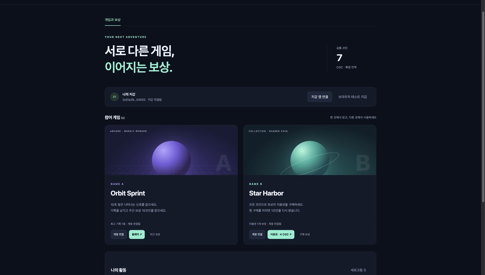

# 검증 기록

## 2026-10-21 사이트 지갑 연결 초기화

사용자의 요청에 따라 로그인 전후에 지갑 연결 초기화 버튼을 추가했다. 기존 서버 세션 종료를 요청하고 브라우저 세션·메모리의 지갑 제공자·계정·게임 로그인 정보를 비운 뒤 새로고침한다. 초기화 중 이전 로그인 응답이 도착해도 세션을 다시 저장하지 않도록 세대 번호를 검사하며, 늦게 도착한 응답의 토큰도 종료한다. 계정에 등록된 로그인 지갑과 수령 지갑, 계정·게임·보상·결제 데이터는 삭제하지 않는다.

연결 해제는 현재 origin의 `wallet_revokePermissions({eth_accounts:{}})`만 요청하며 성공 응답을 확인한다. 지원하지 않거나 5초 내 응답이 없으면 완전 해제로 표시하지 않고 Ronin의 Connected dApps에서 직접 해제하도록 안내한다. 실제 Chrome에서 앱의 초기화 버튼 실행과 이 안내를 확인했다. Ronin 2.12.0의 Settings → Connected dApps에 localhost 한 개만 남아 있는 것을 확인한 후 해당 연결을 해제했고, Settings의 **Connected dApps 0**으로 완전 해제를 확인했다. 이후 Connect Request → Connect (1) → Saigon 네트워크 전환 → 로그인 메시지 Sign을 처음부터 다시 진행했으나 `personal_sign`은 여전히 `WALLET_IS_LOCKED`를 반환했다. 연결 초기화는 완료됐지만 로그인 문제를 해결한 것은 아니다.

로그인 코드와 분리된 `/wallet-check.html` 진단 페이지도 추가했다. 지갑 연결 승인 → 일반 메시지 `personal_sign` → 반환 서명 검증만 수행하고 원문 오류를 표시한다. 개인키·서명값을 서버에 전송하거나 체인 거래를 만들지 않는다.

실제 Ronin에서 이 최소 진단의 일반 메시지에도 Sign을 눌렀고, `code=-32603`, `data.cause.code=WALLET_IS_LOCKED`, `Please unlock wallet first!`를 재현했다. 이 요청에는 SIWE, 로그인 서버, 계정·체인 검사, 체인 전환이 없다. 따라서 앱의 후속 계정 검사에서 성공한 서명을 거절하는 상황과 구분한다. [최소 진단 결과](ronin-minimal-sign-error.jpg)를 남겼다. 서명 생성 실패의 내부 원인과 Ronin 확장 프로그램 자체 재시작 후 성공 여부는 아직 확인되지 않았다.

이번 변경의 타입 검사·브라우저 번들 생성과 체인 노드를 사용하지 않는 인증·지갑·실행 설정 테스트 31개가 통과했다. 지갑 권한 해제 요청의 범위, 미지원·거절·무응답을 성공으로 표시하지 않는 처리도 검증했다.

## 2026-10-21 Ronin 잠금 오류 확인

추가 확인: 실제 Ronin 화면은 계정·잔액을 표시하고 Sign 버튼도 누를 수 있었다. Sign을 누른 뒤 `personal_sign`이 서명 대신 중첩 잠금 오류를 반환했다. 이 코드는 사용자 화면이 잠겨 있다는 직접 증거가 아니므로 안내를 “지갑 앱이 서명값을 반환하지 못했다”로 수정했다. 사용자에게 이미 서명했다는 피드백을 받은 상태에서 단순히 잠금을 풀지 않았다고 해석하지 않는다. 같은 체인인 경우 불필요한 `wallet_switchEthereumChain`을 호출하지 않도록 변경했으며, 이 변경만으로 서명 실패가 해소되지는 않았다. 지갑을 한 번 잠근 후 다시 여는 상태 갱신은 사용자의 비밀번호 입력을 필요로 하므로 사용자 확인을 기다린다.

실제 Chrome의 Ronin에서 `eth_requestAccounts`는 주소를 반환하지만 `eth_accounts`는 빈 배열을 반환하는 상태를 재현했다. 기존 코드는 이 단계에서 계정 변경·잠금 오류로 연결을 중단했다. 사용자가 누른 연결·서명 동작에서는 빈 목록 또는 지원하지 않는 조회 메서드 오류에 한해 `eth_requestAccounts`로 승인을 다시 확인한다. 다시 받은 주소와 원래 서명 대상이 일치해야 하며 체인 검사도 유지한다. 연결 거절·빈 승인·다른 계정·다른 체인·전송 장애는 통과시키지 않는다.

연결 단계를 통과시킨 뒤 실제 Ronin 로그인 메시지에 서명 승인을 눌렀다. `personal_sign`은 `-32603`과 `data.cause.code=WALLET_IS_LOCKED`, `Please unlock wallet first!`를 반환했다. 로그인 성공이나 서명 완료로 기록하지 않았다. 지갑의 잔액 화면과 연결 주소가 표시되어도 실제 키 서명 기능은 잠겨 있을 수 있음을 확인했다.

앱은 이 중첩 오류를 잠금 해제 안내로 바꿔 표시한다. 로그인 실패 이유는 버튼 아래에도 유지한다. 원문 문자열 서명도 같은 잠금 오류를 반환했으므로, 진단용 원문 변환과 RPC 로그는 제거하고 기존 hex 메시지 서명을 유지한다. 사용자 지갑의 비밀번호 입력·잠금 해제 후 최종 로그인은 아직 확인하지 못했다.

`npm run typecheck`, `npm run build:web`, 체인 노드를 사용하지 않는 인증·지갑·실행 설정 테스트 28개가 통과했다. 추가 검증은 빈 계정 목록의 승인 재확인, 거절·계정·체인 불일치, 지원하지 않는 메서드와 전송 실패의 구분, 중첩 잠금 오류의 안내 문구다.

## 2026-10-21 지갑 로그인

공통 포털 기본 로그인을 SIWE 메시지 서명으로 추가했다. 기존 아이디·비밀번호 로그인, 로그인 후 새 지갑 등록, 기존 수령 지갑·승인 지갑의 계정 해석을 제공한다. 새 지갑 가입은 player로 제한하며 로그인 지갑 등록으로 계약 권한 주소나 기존 수령 주소를 변경하지 않는다.

- `npm run typecheck`, `npm run build:web`, `npm run openapi` 성공.
- `node --import tsx --test tests/wallet-auth.test.ts tests/wallet.test.ts tests/runtime.test.ts`: 24개 통과. 이 검증은 로컬 체인 노드를 실행하지 않는다.
- 실제 개인키 서명과 HTTP 경로를 사용하는 인증 테스트로 신규 가입·기존 역할 유지·계정 연결·다른 계정 지갑 충돌·만료·원문 변조·동시 재사용·용도 혼동·게임 API 키 오용·origin 검사·속도 제한·DB 재시작을 검증했다. 인증 테스트에서 RPC 호출은 발생하지 않는다.
- 실행 중인 외부 Saigon 환경의 기존 관리자 지갑으로 로그인 HTTP 200, admin 역할 유지, 동일 서명 재사용 HTTP 422, 로그아웃 HTTP 200을 확인했다. 거래를 제출하지 않았다.
- 변경 전 DB를 `var/recovery-wallet-login-20261021/`에 비공개 백업했다. 반영 후 기존 계정 3개, 게임 2개, 게임 계정 연결 2개, 수령 지갑 1개, 보상 2개, 결제 1개, 작업 6개가 유지됐다.
- 실제 Chrome에서 지갑 로그인 버튼, Ronin Wallet 선택 창, 선택 취소, 기존 관리자 비밀번호 로그인과 로그아웃을 확인했다. [첫 화면](wallet-login.jpg)을 저장했다. 확장 프로그램의 실제 로그인 서명 승인 완료와 MetaMask 실기기 검증은 수행하지 않았다.
- 서버 상태는 외부 RPC 사용, `/health` HTTP 200 (`ready`, `workerError=null`)이다. 로컬 체인 포트 8545는 열리지 않았다. 이번 변경에서는 계약·로컬 노드 통합 테스트를 실행하지 않았다.

일반 개인키 EVM 지갑만 지원한다. 스마트 계약 지갑의 EIP-1271 검증, 로그인 지갑 해제·계정 병합·비밀번호 재설정은 별도 구현 사항이다. 기존 비밀번호는 기존 계정의 로그인 수단으로 유지하며 새 지갑 가입자에게 비밀번호를 발급하지 않는다.

## 2026-10-20 로컬 RPC 시간 초과 복구

지갑 인식과 별개로 서버의 로컬 체인 `eth_chainId` 조회에서 10초 시간 초과를 재현했다. 당시 Anvil은 CPU 한 코어를 계속 사용했고 상태 파일은 약 7.4GiB까지 커져 있었다. 전체 과거 상태를 포함한 덤프를 2초마다 반복하는 설정이었다.

로컬 채굴 간격을 5초, 주기 저장을 30초, 과거 상태의 디스크 캐시를 128개로 조정했다. npm 실행 래퍼가 먼저 종료되는 문제도 제거하고 실제 네이티브 Anvil의 저장 완료를 기다리도록 변경했다. 확정 판정을 느슨하게 하거나 RPC 실패를 성공으로 바꾸지는 않았다.

현재 환경은 `var/recovery-20261020T134732Z/`에 전체 체인 상태와 네트워크·게임 DB를 백업한 뒤 복구했다. 상태 파일의 블록 36,794개, 거래 레코드 17개, 현재 계정 상태를 보존하고 최근 블록 및 DB 예산 스냅샷에 필요한 과거 상태 33개를 남겼다. 파일은 7,941,091,223바이트에서 133,281,431바이트로 감소했다. 원래 과거 상태는 전체 백업에 남아 있다. 서비스 DB의 업무 데이터를 초기화하지 않았다.

- 게임 4개의 예산, 연결된 이용자 지갑의 잔액, 총발행량·보유분·보관금·정산 계약 잔액이 복구 전과 일치했다.
- 기존 업무 거래 11건의 성공 영수증과 기준 블록 해시가 보존됐다. 자금 보존 대조는 정상이다.
- 복구 후 약 35초 동안 health 조회 100회 모두 HTTP 200, `workerError: null`이었고 최대 지연은 83ms였다. 이 검사는 주기 저장 구간을 포함한다.
- `npm run check`는 TypeScript·Solidity 검사와 총 **32개 테스트를 통과**했다. 추가한 로컬 지속 상태 회귀 검증은 빈 블록 800개를 생성한 뒤 종료·재시작하고 잔액·영수증·최근 과거 블록 조회를 대조한다.
- 실제 Chrome 관리자 화면에서도 새로고침 후 예산·보관금·자금 보존 상태의 정상 조회를 확인했다. [복구된 화면](local-rpc-recovery.jpg).

이 결과는 로컬 개발 환경 복구 검증이다. Saigon 거래를 새로 실행한 결과나 무기한 부하 시험으로 해석하지 않는다.

## 2026-10-20 확장 프로그램 지갑 인식 수정

기존 화면은 `window.ethereum`만 참조해 Ronin의 전용 제공자를 인식하지 못했다. EIP-6963 탐색과 `window.ronin.provider` 호환 경로, 지갑 선택창을 추가했다. 계정 요청·네트워크 전환·소유 확인·구조화 서명은 선택한 제공자로 보내며 서명 전 계정과 체인을 대조한다. 로컬 체인을 추가할 때 기반 통화는 ETH로 표시한다.

- `npm run check`: TypeScript 검사, Solidity 컴파일, 기존 계약·API·게임 통합 검증 24개와 지갑 회귀 검증 7개, 총 **31개 통과**.
- `npm run build:web`: 브라우저 번들 생성 성공.
- 지갑 회귀 검증은 Ronin 단독 설치 형태, 여러 지갑·중복 알림, 지연 주입, 선택 제공자 유지, 네트워크 추가·전환, 승인 거절, 계정·체인 불일치를 검증한다. 자동 검증의 지갑 제공자는 모의 구현이다.
- 실제 사용자 Chrome의 로컬 관리자 화면에서 **지갑 앱 연결**을 눌러 **Ronin Wallet 선택 항목이 나타남**을 확인했다. [브라우저 확인 화면](wallet-provider-selection.jpg).
- 이 브라우저 확인은 지갑 탐색·선택 UI까지다. 사용자의 지갑 잠금 해제·연결 승인·실제 서명·테스트넷 거래를 완료한 검증으로 해석하지 않는다.

검증일: 2026-10-19 KST. 로컬 실행, 외부 계약 배포, 외부 최종 확정은 아래처럼 구분한다.

## 로컬 통합

TypeScript 검사, Solidity 컴파일, 실제 Anvil 계약을 사용하는 통합 테스트 **24개 통과**. `npm audit`는 취약점 0개다. Node 22의 내장 SQLite를 사용한다.

| 영역        | 확인 결과                                                                    |
| ----------- | ---------------------------------------------------------------------------- |
| 기본 순환   | 이용자 7 CGC, A 예산 90 CGC, B 예산 3 CGC, 이용권 1개                        |
| 총발행량    | 순환 전후 1,000,000 CGC 유지                                                 |
| 중복·권한   | 요청 키·보상 참조 중복 차단, 내용 충돌, 다른 게임 접근 거절                  |
| 서명        | 무서명·변조·다른 체인 거절, 재사용 차단, permit 선제출 허용                  |
| 동시 승인   | 같은 permit nonce 충돌 후 같은 결제로 승인 재제출                            |
| 예산        | 보상·인출 예약, 예산 초과 거절, 운영자 서명, 추가 예치                       |
| 회계        | 직접 전송을 미분류 잔액으로 유지, 캐시 차이 탐지·복구·감사                   |
| 거래 복구   | 제출 전·후 중단, 같은 원문 거래 복구, 동일 nonce 수수료 대체                 |
| 블록 재구성 | 미확정 포함 취소 후 재전송, 확정 전 완료 이벤트 없음                         |
| 결제·지급   | 환불/지급 시작 양방향 경합, 지급 직후 게임 재시작에도 한 번 지급             |
| 만료·복구   | 만료 서명 거절, 지급 시작 기한 환불, 공동 승인 예외 환불                     |
| 게임 잠금   | 예외 환불 잠금 이후 지급 차단, 이미 지급된 주문 잠금 거절                    |
| 배포 변경   | 접수된 배포·수령 지갑 유지, 변경 후에도 보상 중복 차단                       |
| 영속 이벤트 | 이벤트 저장 실패 시 커서도 함께 롤백, 재시작 후 누락 없음                    |
| 확정 지연   | RPC 장애 시 진행 보류, 과거 확정 블록으로 서명 만료를 계산하지 않음          |
| 오류 분류   | 계약 호출 오류로 감싸진 통신 장애도 실패 확정 없이 같은 작업·예약으로 재시도 |

Chrome에서 이용자 로그인 → 브라우저 테스트 지갑 소유 확인 → 두 게임 연결 → 게임 A 플레이 → 주간 보상 → 게임 B 구매 → 이용권 지급 → 구매 보상을 직접 실행했다. 화면 잔액 7 CGC와 이용권 1개를 확인했다. 관리자 화면에서도 예산 합 93 CGC, 보관금 0 CGC, 자금 보존 정상 상태를 확인했다.

개발 체인은 2초 주기로 채굴한다. 저장된 상태를 재시작한 뒤 별도 거래 없이 두 블록이 생성되고, 최신 블록 시각과 현재 시각의 차이가 1초인 것을 확인했다. 자동 테스트의 체인은 즉시 채굴을 사용한다.



## 게임 등록과 카탈로그 추가 검증

이번 등록·카탈로그 변경은 로컬 Anvil의 실제 계약과 Chrome에서 검증했다. 통합 테스트 24개에는 다음 시나리오가 포함된다.

- 운영자 신청은 검토 중 비공개이며, 관리자 승인 후에도 계약이 최종 확정되기 전에는 노출하지 않음
- 승인 확정 후 게임 소개·장르·실행 URL 공개, 재시작 후 정보 유지, API 자격증명 발급 가능
- 다른 운영자의 신청·게임 관리 접근 차단, 운영자 임의 승인과 운영자 ID 변조 차단
- 중복 신청·승인 방지, JSON 필드 순서가 달라도 같은 신청으로 처리
- 반려 사유 확인과 본인의 같은 게임 ID 재신청, 잘못된 URL·스크립트 URL 거절
- 계약 등록 실패 후 같은 게임 ID로 관리자 재시도, 중지·재활성화 시 카탈로그 반영

브라우저에서는 `catalog-ui-test`를 신청해 검토 대기를 확인하고, 관리자로 승인한 뒤 참여 게임 수가 2개에서 3개로 바뀌는 것을 확인했다. 이름·소개·장르·실행 링크와 예산 배분 선택지도 갱신됐다. 동적으로 카드를 다시 만든 뒤 기존 게임 A를 플레이해 1점 기록까지 확인했다. 중복 신청은 한 건으로 유지됐고 신청 폼도 정상적으로 초기화됐다.

검증용 게임은 확인 후 운영을 중지해 기본 이용자 목록에 남기지 않았다. 기존 예제 게임의 잔액과 예산은 유지했다. [운영자 등록 화면](operator-registration.png) · [등록 게임 공개 확인](catalog-registration.png)

## Saigon 외부 환경

**기본 순환이 실제 Saigon 계약에서 최종 확정까지 통과했다.** 완료 시각은 2026-10-19 10:51 KST다. 모든 업무 작업과 거래는 `FINALIZED`이며 결제는 `COMPLETED`다.

공식 faucet에서 5 테스트 RON을 수령하고 별도 중계 지갑에 테스트 가스를 보냈다. 실제 RPC의 chain ID `202601`, 계약 코드·운영 권한·6자리 소수점·지급 시작 기한을 확인했다. 검증 배포는 `saigon-v2`다.

| 계약      | 주소                                                                                                                                    |
| --------- | --------------------------------------------------------------------------------------------------------------------------------------- |
| 공통 토큰 | [0x8cb7b084470ab1d945586052a586b093fc1235d0](https://saigon-explorer.roninchain.com/address/0x8cb7b084470ab1d945586052a586b093fc1235d0) |
| 정산      | [0x1a198d6e631b7892d204a14a1c3d7c6818093a40](https://saigon-explorer.roninchain.com/address/0x1a198d6e631b7892d204a14a1c3d7c6818093a40) |

| 최종 결과   |                 값 |
| ----------- | -----------------: |
| 이용자 잔액 |              7 CGC |
| 게임 A 예산 |             90 CGC |
| 게임 B 예산 |              3 CGC |
| 이용권      |                1개 |
| 결제 보관금 |              0 CGC |
| 총발행량    | 1,000,000 CGC 유지 |

실제 HTTP API와 이용자 서명, 서로 다른 게임 DB 두 개, 외부 계약으로 실행했다. Smoke에서는 두 게임 처리기를 같은 테스트 프로세스 안에서 구동했다. 아이템 지급 직후 의도적인 중단을 발생시킨 뒤 게임 DB를 닫고 새 처리기로 재개했으며, 이용권 1개와 지급 기록 1건을 확인했다. 브라우저 화면을 통한 기본 순환 검증은 위 로컬 환경에서 수행했다.

확정 블록 `56545934`에서 다시 조회한 정산 계약 잔액은 999993.000000 CGC다. 미배분 보유분 999900.000000 CGC와 게임 예산 합 93.000000 CGC의 합과 일치하며 보관금은 0이다. 총발행량은 배포 시점의 과거 블록과도 대조했다.

### 거래와 가스

| 단계            | 실제 거래                                                                                                              | 가스 사용량 |
| --------------- | ---------------------------------------------------------------------------------------------------------------------- | ----------: |
| A 예산 100 배분 | [거래 1](https://saigon-explorer.roninchain.com/tx/0xf3da470662b0d3a38ea85408cca479e7930d12ad8aff114df3283d34f358e165) |     108,885 |
| A 보상 10       | [거래 2](https://saigon-explorer.roninchain.com/tx/0x14d19223d368f85351fba7b10cd57050febcea6d60c75caab42b14fd1af199fb) |     103,226 |
| B 결제 4        | [거래 3](https://saigon-explorer.roninchain.com/tx/0x0b53e0410c8dac124448c361fe17a8fc5afcae5c5ac344f87c3d9b18009d92b5) |     276,026 |
| 지급 시작       | [거래 4](https://saigon-explorer.roninchain.com/tx/0xd7a1249595271b213eaac42e932ebd7b8baeb824e0fa1752a71698afb608847f) |      40,406 |
| B 수입 4 정산   | [거래 5](https://saigon-explorer.roninchain.com/tx/0xa6a8e0c4b0f18c239675eec76a3e5232f55af290f0a49ce0b65176d2bdb33b11) |      74,365 |
| B 재보상 1      | [거래 6](https://saigon-explorer.roninchain.com/tx/0x01c0b536d415cade1e60209d1f22eb84ba6345041aadf627b7e8bffb1a1f1076) |      86,126 |

순환 거래 6건의 가스 사용량은 **689,034**다. 실행 수수료는 **0.014469714 테스트 RON**, RPC가 보고한 L1 수수료 합은 **1076 wei**다. 두 항목의 합은 0.014469714000001076 테스트 RON이다. 계약 배포·faucet·사전 설정 거래는 이 합계에서 제외한다.

영수증·업무 상태·최종 회계 대조·가스 합계는 [공개 검증 결과](saigon-verification.json)에 저장했다. 개인키·자격증명·서명 거래 원문은 이 파일에 포함하지 않는다. 원본 실행 로그와 클라이언트 데이터는 `var/saigon-smoke.log`, `var/smoke-saigon-v2/`에 있다.

### 확정과 복구 관측

외부에서는 최신 블록보다 최종 확정이 20분 이상 지연됐다. 확정 기준을 유지하고 Saigon 승인·지급 시작 기한을 각각 60분으로 설정했다. 로컬 기한은 15분이다. 서명 만료는 최신 체인 시각으로 계산하고, 아이템은 지급 시작의 최종 확정 후에만 생성한다. 공식 RPC와 공식 문서의 dRPC에서 같은 확정 블록 해시도 확인했다.

실행에는 중단과 재개가 포함된다. 보고서의 `steps.elapsedMs`는 각 재개 이후 해당 단계의 대기 시간이며, 전체 실행 시간이나 평균 처리 성능으로 해석하지 않는다. 같은 run ID와 업무 식별자로 재개해 배분·보상·결제를 중복 실행하지 않았다.

외부 RPC의 `eth_getLogs` 조회 한도가 200블록인 것을 실제 오류 응답으로 확인했다. 색인은 200블록 이하로 조회하며, 색인 장애가 거래 확정 복구와 기한 환불을 막지 않도록 분리했다. 계약 호출 오류로 감싸진 통신 장애도 작업과 예약을 유지해 재시도한다. 관련 회귀 검증을 포함한 로컬 통합 테스트 24개가 통과했다.

로컬 EVM과 Saigon에서는 각각 독립된 토큰과 잔액으로 같은 게임 API를 실행했다. 브리지나 환경 간 자산 이전은 구현 범위에서 제외한다.

```sh
node --env-file=var/saigon.env --import tsx scripts/status.ts
```

완료된 환경에서 `smoke.ts`를 다시 실행하면 새 run ID로 새로운 검증 순환을 시작한다. 중단된 실행은 기존 run ID로 재개한다.
