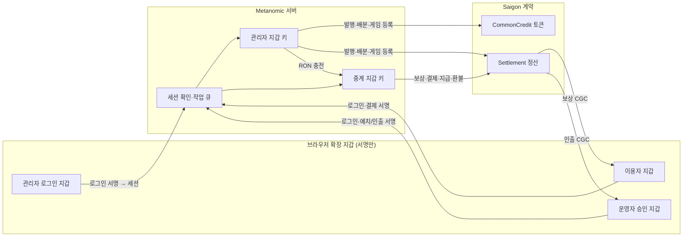

# 지갑과 권한 구조

Metanomic에 등장하는 지갑의 종류, 각 지갑의 권한, 서로의 관계를 정리한 문서다. 코드 기준은 `contracts/`, `src/chain.ts`, `src/worker.ts`, `src/wallet-auth.ts`다.

## 1. 한눈에 보기

| 지갑                   | 주인            | 키 위치                | 계약 권한      | CGC 보관               | 가스비(RON)      |
| ---------------------- | --------------- | ---------------------- | -------------- | ---------------------- | ---------------- |
| **관리자 지갑**        | 서버            | `var/saigon.env`       | 있음 (관리)    | 없음 (발행분은 보유분) | 자기 거래분 부담 |
| **중계 지갑**          | 서버            | `var/saigon.env`       | 있음 (실행)    | 없음                   | 대부분 부담      |
| **관리자 로그인 지갑** | 네트워크 관리자 | 브라우저 확장 프로그램 | 없음           | 없음                   | 없음             |
| **운영자 승인 지갑**   | 게임 운영자     | 브라우저 확장 프로그램 | 자기 게임 한정 | 운영자 개인 CGC        | 없음             |
| **이용자 지갑**        | 이용자          | 브라우저 확장 프로그램 | 없음           | 보상으로 받은 CGC      | 없음             |

- 서버 지갑 두 개는 **서버가 서명하고 제출하는 실행용 지갑**이다. 사람이 확장 프로그램에 넣어 쓰지 않는다.
- 사람 지갑 세 종류는 **서명만** 한다. 가스비가 드는 블록체인 거래는 모두 서버 지갑이 제출하므로 사람 지갑에는 RON이 필요 없다.

## 2. 서버 지갑

### 관리자 지갑

- 설치할 때 `scripts/bootstrap-saigon.ts`가 무작위 키로 만들어 `var/saigon.env`의 `ADMIN_PRIVATE_KEY`에 저장한다. 직접 준비한 키를 넣을 수도 있다.
- 배포(`scripts/deploy.ts`) 때 두 계약을 배포하고 다음 권한을 받는다.
  - CommonCredit: `DEFAULT_ADMIN_ROLE`, `MINTER_ROLE` (CGC 발행)
  - Settlement: `DEFAULT_ADMIN_ROLE`, 복구 관리자 `recoveryAdmin` (배포 후 변경 불가)
- 초기 발행분은 이 지갑을 거쳐 Settlement 보유분으로 들어가므로 관리자 지갑의 CGC 잔액은 평소 0이다.
- 배포 가스비와 자기 거래(배분·발행·게임 등록 승인·중계 지갑 충전)의 가스비를 낸다. 포털의 게임 켜기·끄기와 삭제는 DB에서만 처리하므로 거래가 없다. 체인에 중지·재개를 기록할 때만 거래가 생긴다.

### 중계 지갑

- 관리자 지갑과 같은 방식으로 만들어 `RELAYER_PRIVATE_KEY`에 저장한다.
- Settlement 배포 때 `RELAYER_ROLE`을 받는다. 서버는 시작할 때 이 키가 배포 정보의 중계 주소와 일치하는지 검사한다.
- 이용자·운영자 활동마다 거래를 제출하므로 RON을 가장 많이 쓴다. 실측 가스비는 보상 약 0.002 RON, 구매 1건(결제·지급 시작·완료) 약 0.0082 RON이다 (21 gwei 기준).

### 권한 분리

권한은 서버가 아니라 계약의 `onlyRole` 검사로 강제한다. 권한 없는 지갑의 호출은 계약이 거부한다.

| 계약 함수                                      | 관리자 지갑 | 중계 지갑 | 추가로 필요한 서명            |
| ---------------------------------------------- | :---------: | :-------: | ----------------------------- |
| `mint` (토큰)                                  |      ✓      |           | 없음                          |
| `fundReserve`                                  |      ✓      |           | 없음                          |
| `allocate`                                     |      ✓      |           | 없음                          |
| `registerGame` (등록 승인·체인 중지/재개 기록) |      ✓      |           | 없음                          |
| `reward`                                       |             |     ✓     | 없음 (게임 예산 한도 안)      |
| `pay`                                          |             |     ✓     | **이용자** 결제 서명          |
| `claimDelivery`, `fulfill`                     |             |     ✓     | 없음 (결제 상태 전이)         |
| `refund`                                       |             |     ✓     | 없음 (지급 시작 전만)         |
| `budgetAction` (예치·인출)                     |             |     ✓     | **운영자 승인 지갑** 서명     |
| `resolve` (공동 승인 환불)                     |             |     ✓     | **운영자 + 복구 관리자** 서명 |

- 중계 지갑은 CGC를 발행할 수 없고, 관리자 지갑은 보상을 직접 지급할 수 없다.
- 두 지갑 모두 이용자·운영자의 CGC를 당사자 서명 없이 옮길 수 없다. 예외는 `reward`로, 게임 예산에서 중계 권한만으로 지급된다.
- 관리자·중계 권한은 현재 관리자 지갑이 `grantRole`/`revokeRole`로 바꿀 수 있지만 이를 위한 화면이나 스크립트는 없다.

### 가스 관리

- 작업 처리기가 1분마다 중계 지갑 잔액을 확인한다. `RELAYER_MIN_RON`(기본 0.5) 미만이고 진행 중인 충전이 없으면 관리자 지갑에서 `RELAYER_TOPUP_RON`(기본 2)을 보낸다. 관리자 지갑에는 `ADMIN_MIN_RON`(기본 0.5)과 송금 수수료를 남긴다. `RELAYER_AUTO_FUND=0`이면 끈다.
- 관리자 화면 **현황 → 운영 지갑 가스**에서 두 지갑의 잔액·경고·충전 내역을 보고, **관리자 지갑에서 충전**으로 원하는 양을 보낼 수 있다. 같은 유지분 규칙을 적용한다.
- 충전은 `fundRelayer` 작업으로 다른 관리자 거래와 같은 저장·재전송·복구를 따른다.
- 평소에는 **관리자 지갑만 faucet으로 채우면** 된다.

## 3. 사람 지갑

### 관리자 로그인 지갑

- 관리자 화면에 들어가는 열쇠다. **계약 권한은 없다.** 계약은 이 주소를 알지 못한다.
- 서버 DB `login_wallets`에 `주소 → admin 계정`으로 기록된다. 배포 때 서버 관리자 지갑 주소가 자동 등록되고, 사람이 쓸 지갑은 다음 방법으로 등록한다.
  - **첫 설치**: 포털 첫 화면에서 배포가 출력한 초기 설정 코드(`var/admin-setup-code`)로 연결한다.
  - **지갑을 잃었을 때**: 서버에서 `scripts/admin-setup-code.ts`로 새 코드를 발급해 다시 연결한다.
  - **추가 지갑**: 로그인한 뒤 지갑·계정 탭의 **로그인 지갑 등록**.
- 지급 중단 복구의 공동 승인 서명은 복구 관리자(서버 관리자 지갑) 주소만 계약이 받는다. 관리자 로그인 지갑으로는 할 수 없다.

### 운영자 승인 지갑

- 이용자가 **게임 운영자 신청**을 할 때 서명한 지갑이다. 관리자가 승인하면 계정이 운영자로 바뀌고 이 지갑이 승인 지갑(`accounts.wallet`)이 된다.
- 운영자가 게임을 등록하면 계약의 게임 운영자 주소(`games[gameId].operator`)로 기록되며 **이후 바꿀 수 없다.**
- 예치·인출과 공동 승인 환불의 운영자 서명을 한다. 운영자가 관리자에게 발행받거나 예산에서 인출한 CGC가 이 지갑에 들어온다.
- 게임 예산 자체는 이 지갑이 아니라 Settlement의 게임 장부(`budgets[gameId]`)에 있다.

### 이용자 지갑

- 게임에 지갑으로 로그인하면 게임 서버가 그 주소를 검증하고 보상·결제에 사용한다. 포털 가입이나 별도 수령 지갑 등록은 필요하지 않다. 나중에 같은 지갑으로 포털에 로그인하면 조회용 계정과 지갑 기록이 만들어지고 이전 내역도 표시된다.
- 보상 CGC가 이 지갑으로 들어오고, 결제할 때 이 지갑의 CGC가 나간다. 결제 내용과 토큰 사용 허가(permit)에 서명하며 가스비는 내지 않는다.

## 4. 관리자 지시가 실행되는 방식

관리자 로그인 지갑과 서버 지갑 사이에는 **서명 관계나 계약 관계가 없다.** 연결은 서버 안에서만 일어난다.

1. 관리자 로그인 지갑이 로그인 메시지(SIWE)에 한 번 서명한다. 가스비와 체인 기록은 없다.
2. 서버가 서명을 확인하고 `login_wallets`에서 계정을 찾아 세션 토큰을 발급한다.
3. 관리자 화면의 요청은 세션 토큰으로 인증되고, 서버는 계정 역할이 `admin`인지만 확인한다.
4. 서버가 작업을 큐에 넣고 관리자 키 또는 중계 키로 서명해 제출한다.
5. 계약에는 서버 키의 서명만 남는다. 누가 지시했는지는 서버의 관리 기록(`audit_events`)에만 남는다.

이용자 결제와 운영자 예치·인출은 다르다. 당사자 지갑의 서명이 계약에 함께 제출되므로, 서버도 그 서명 없이는 해당 자금을 옮길 수 없다.

## 5. 신뢰 모델과 위험

- **관리자 쪽 신뢰는 서버에 있다.** 세션 토큰·DB·서버 키 중 하나가 유출되면 관리자 로그인 지갑 없이도 관리자 작업(발행·배분·게임 등록·충전)을 실행할 수 있다.
- **관리자 로그인 지갑은 계약 권한이 없지만 서버를 움직이는 리모컨이다.** 복구 문구를 안전하게 보관하고 다른 사람에게 넘기지 않는다.
- **중계 키 유출 시** 모든 게임 예산이 `reward`로 빠져나갈 수 있다. 이용자·운영자 지갑의 CGC는 서명이 없으므로 안전하다.
- **관리자 키 분실 시** 그 배포의 발행·배분·게임 등록·복구 승인이 영구히 불가능하다. 복구 관리자는 바꿀 수 없으므로 계약을 새로 배포해야 한다.
- 실제 가치가 생기면 서버 관리자 키 대신 사람이 직접 서명하는 다중 서명 지갑으로 관리자 권한을 옮기고, 키는 키 관리 서비스에 둔다.

## 6. 배포 후 바꿀 수 없는 것

| 항목                  | 값의 출처                 |
| --------------------- | ------------------------- |
| 복구 관리자           | 배포 때 관리자 지갑       |
| 게임별 운영자 주소    | 첫 게임 등록 때 승인 지갑 |
| CGC 발행 한도         | 배포 설정 `SUPPLY_CAP`    |
| 관리자·중계 지갑 분리 | 계약이 같은 주소를 거부   |

## 7. 운영 체크리스트

- 관리자 지갑 RON 잔액을 유지한다. 중계 지갑은 자동 충전된다.
- `var/saigon.env`(서버 키)와 `var/` DB를 암호화해 주기적으로 백업한다.
- 관리자 로그인 지갑의 복구 문구를 보관한다. 잃으면 `scripts/admin-setup-code.ts`로 새 지갑을 연결한다.
- 관리자 지갑과 중계 지갑의 키는 브라우저 확장 프로그램에 넣지 않는다.

## 게임 지갑 로그인과 보상 주소

일반 이용자는 각 게임에 지갑으로 로그인하면 된다. 게임 서버가 게임 자체의 서명을 검증하고 그 세션의 주소를 보상 `recipient`와 주문 `payer`로 사용한다. Metanomic 가입·게임별 연결 코드·포털의 별도 수령 지갑 연결은 새 연동의 필수 단계가 아니다. 운영자 게임 등록과 예산 관리는 그대로 필요하다. 포털은 같은 지갑의 잔액·내역을 확인하거나 결제를 이어가는 선택 화면이다. 기존 `playerId`·수령 지갑 연결 연동은 호환 경로로 유지한다.
